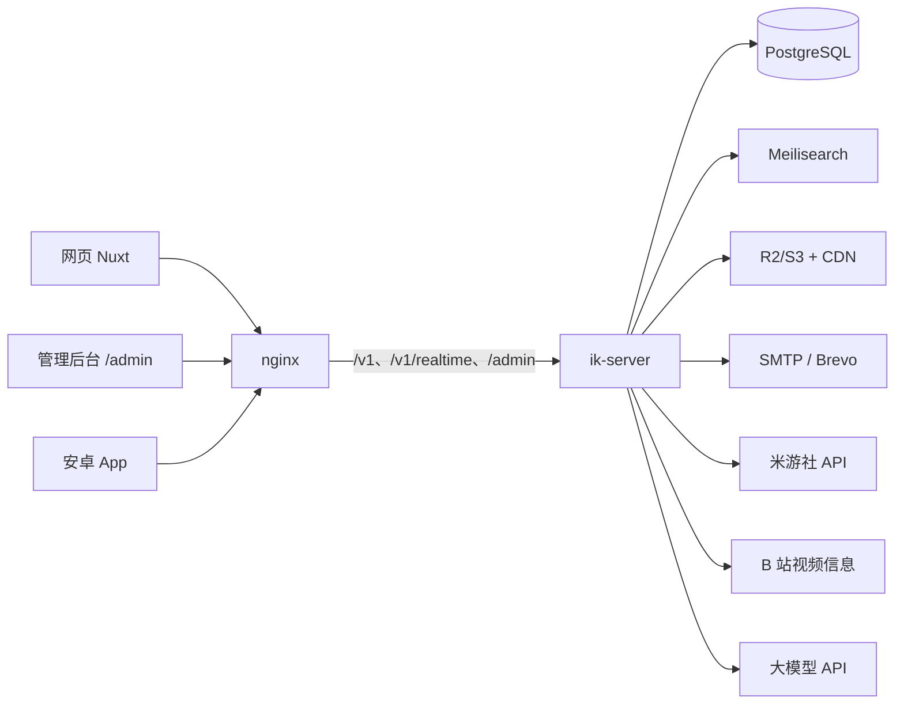

# 架构

## 总览

模块化单体：一个 `ik-server` 进程承担 HTTP API、WebSocket 网关、后台任务与定时任务、
AI 编排，并提供编进可执行文件的管理后台页面（`/admin`）。外部依赖只有 PostgreSQL、Meilisearch、S3 兼容对象存储、SMTP/Brevo、米游社 API、
B 站视频信息接口、大模型 API。没有 Redis，没有 AstrBot，没有独立 worker 进程。



## crate 划分与依赖方向

每个 crate 的职责见 `AGENTS.md`「目录结构」（只在那里维护）。这里只讲依赖方向：下层不知道上层，
依赖只能从上往下。按层从下到上（同层之间不互相依赖，除非下面单独写明）：

| 层 | crate | 直接依赖（省略 kernel） |
|---|---|---|
| 0 | `kernel`、`mail` | 无业务域 |
| 1 | `auth` | — |
| 2 | `economy`、`social`、`media`、`mihoyo`、`realtime` | `auth` |
| 3 | `exam` | `auth, economy` |
|   | `cosmetics` | `auth, media` |
|   | `messaging` | `auth, social, media` |
| 4 | `notify` | `auth, social, messaging, media` |
| 5 | `content` | `auth, economy, social, notify, media` |
| 6 | `comments` | `auth, economy, social, notify, content, media` |
| 7 | `feed` | `auth, content, comments` |
|   | `search` | `auth, social, content, comments` |
|   | `moderation` | `auth, content, comments, notify, media` |
|   | `profile` | `auth, social, economy, content, comments, media, cosmetics, mihoyo, realtime` |
| 8 | `account` | `auth, mihoyo, profile` |
|   | `ai` | `auth, media, messaging, social, content, comments, profile, feed, search, economy` |
| 9 | `admin` | `auth, economy, content, comments, exam, moderation, search, ai` |
| — | `legacy` | `media`（一次性数据导入，模块边界的例外，见 ADR 0003） |
| — | `server` | 全部（唯一组装所有域的地方） |

- `kernel`：不依赖任何业务域。提供配置、Problem 错误、ID、时间、游标、鉴权上下文、
  事件总线、任务入队、HTTP helper（客户端 IP、限流 key）。
- 跨域只走对方 crate 的 `service` / `interop`；`repo` 层 `pub(crate)`，表归属唯一域。
- 需要与调用方同一事务的跨域写入，由被调用方提供接收 `&mut PgConnection` 的 interop 函数
  （如 `ik_auth::interop`、`ik_content::interop`、`ik_economy::service::grant_exp`）。
- economy 不能依赖 content，所以投币的入口在 content，记账在 economy；`exam → economy` 是通过奖励。
- 拉黑几乎在每个读写路径上生效，所以 `social` 只放用户之间的关系（关注、拉黑），位于 content 之下，
  由 `ik_social::interop` 提供「任一方向拉黑」判断与列表过滤的排除集合。点赞、收藏、三连是帖子和评论
  上的数据，分别归 content、comments 所有，这样详情和列表可以直接带上「我是否已赞」。
- `feed → auth, content, comments`：热榜要合并点赞（content）与评论（comments）两类活动，所以在两者之上；
  各种信息流的 SQL 仍在 content（帖子表归它），feed 只负责热度计算与组合（把展示位 id 交给 content）。
  相关推荐（`GET /v1/posts/{id}/related`）只看帖子、标签、阅读记录，所以整个在 content 里。
  B 站视频信息（`ik_content::bilibili`，trait 抽象，测试用假实现）在保存帖子的事务之前查询，进程内缓存 10 分钟。
- `profile`：作者主页要汇总账号、关系、经验、帖子与评论、装扮与米游社绑定，所以在各内容域之上，
  只调用各域的 service / interop；依赖它的只有 `account`（注销）与 `ai`（工具读主页）。
- `realtime → auth`：WebSocket 网关（`ik_realtime::Hub`）是事件总线的唯一订阅者，按受众转发；
  会话吊销由 auth 发内部事件 `auth.sessions_changed`，网关收到后复查该用户的连接。
  在线人数：每个实例每 15 秒把连接快照（登录用户、游客连接数）写进 `realtime_presence`，读时合并 45 秒内的行
  （`ik_realtime::presence`），多实例下同一用户只算一次；对外的 `GET /v1/presence` 在 profile 里（要按隐藏主页筛头像，
  所以 `profile → realtime`）。
- `messaging → auth, social`：私聊会话与消息。位于 notify 之下：对方发来的通知要在通知的事务里推进收件人的私聊排序
  （`ik_messaging::interop::touch_direct`）。统一收件箱（私聊会话与通知分组混排、已读）在 `notify` 里组合两边的数据，
  所以实际依赖是 `notify → auth, social, messaging`。WS 的 `typing` 帧由 server 把 `ik_messaging::service::typing`
  注入网关（`RealtimeState::with_typing`），网关仍不依赖业务域。
- `search → auth, social, content, comments`：Meilisearch 只负责找候选与排序，结果经 content / comments 的 service
  回查数据库；建索引与数据库兜底的 SQL 也在这两个域里（`search_docs`、`search_post_ids` 等），search 不读它们的表。
  索引同步订阅事件总线（含 `Audience::Internal` 内部事件）、定时增量扫描、定期全量对账，在事务提交后独立执行。
- `media → auth`：直传上传、媒体文件与图库，位于业务域之下；引用媒体的域（profile 的头像、content 的封面、
  comments 的图片）经 `ik_media::interop::owned_media` 在自己的事务里校验归属，经 `MediaState::views` 取展示数据；
  content、comments、notify、messaging、profile 展示作者时经 `MediaState::avatar_urls` 把头像 id 换成缩略图地址。
- `cosmetics → auth, media`：系统头像、论坛名片的目录。装备状态写在账号上（`ik_auth::interop::equip_*`），
  系统头像的图片 id 也冗余在账号上，所以 `ik_auth::service::authors` 直接给出「装备头像优先，其次自定义头像」，
  展示作者的各域不依赖 cosmetics。目录换图时 cosmetics 在同一事务里调用 `refresh_equipped_avatar` 同步。
- `mail → kernel`：发信通道（SMTP、Brevo）与双通道调度，实现 `ik_kernel::mail::Mailer`，只由 server 装配；
  业务代码只依赖 `Mailer`（验证码邮件在 auth 里事务提交后发送）。
- `mihoyo → auth`：米游社身份（`mihoyo_bindings`）与扫码会话（`mihoyo_qr_logins`，替代旧系统的 Redis 键）。
  建号经 `ik_auth::interop::insert_user_without_email`，登录经 `ik_auth::service::issue_session_with_secret`
  （确定性会话）。上游协议在 `ik_mihoyo::upstream`（trait，测试用假实现；HTTP 实现另有本地桩服务器测试）。
  上游调用都在事务之外；米游社 Cookie 只在确认后的那次请求里用，不落库、不打日志。
- `account → auth, mihoyo, profile`：账号安全概览与注销。注销在一个事务里消费核验（注销验证码或扫码核验，
  扫码会话在数据库里，所以与注销同一事务，回滚时凭证还在）、删除米游社绑定、清空个人资料、账号脱敏并吊销会话；
  提交后发布会话吊销事件（实时网关断开连接）与 `user.renamed`（搜索索引更新作者名）。
- `moderation → auth, content, comments, notify, media`：举报（`reports`）与审核日志（`moderation_log`）。
  隐藏、删除内容经 `ik_content::interop` / `ik_comments::interop`，封禁经 `ik_auth::interop::block_user`，
  通知经 `ik_notify::interop::system`，全部在审核自己的事务里；同一目标的未结案举报是一组，领取、释放、结案先锁整组。
  管理后台接口放在各自的业务域里（`ik_exam::admin`、`ik_ai::admin`、`ik_content::admin`、`ik_cosmetics::admin`、
  moderation 的举报处理与封禁解封），操作者提取器与审计日志在 ik-auth（`ik_auth::admin`）；要编排多个域的
  （账号管理、仪表盘、搜索索引运维、审计日志查看）在最上层的 ik-admin
  （`admin → auth, economy, content, comments, exam, moderation, search, ai`）。审核接口 `/v1/admin/reports*` 需要版主或管理员角色（论坛账号的 `role`，D-062 的「后台账号」不再单独存在）。
  对象存储的读写都在数据库事务之外；校验并发由进程内闸门（`ik_media::gate`）限制。
- `ai → auth, media`：直连 OpenAI 兼容的上游（`ik_ai::llm`，async-openai 的 byot 流式，rustls + ring），
  提供方地址与密钥在部署配置（`IK_AI__PROVIDERS__<名字>__BASE_URL` / `__API_KEY`），模型、角色卡、上限在数据库，
  进程内缓存 60 秒。额度账本在 PostgreSQL：预占在调用模型之前（花钱的闸门 fail-closed），结算与回复定稿同一事务。
  加锁顺序固定为「先全站计数行、再个人计数行」。后台上线前用 `ik-server ai import <json>` 维护配置。
  AI 私聊建在 messaging 之上：会话是 `kind = 'ai'` 的私聊，AI 回复是普通消息（带 `ai_state`）。messaging 不依赖 ai，
  用户发消息、撤回消息时经 `ik_messaging::MessageHooks`（组装时由 `AiState::install_hooks` 注册）在同一事务里通知 ai
  建任务或置停止信号；回复由后台任务 `ai.dm_reply` 生成：准备（锁会话行、复核、预占、建占位）→ 事务外流式调用
  → 定稿（锁会话行、写正文、结算、审计），三段各自是短事务，实时事件都在提交后发出。
  AI 评论回复同理建在 comments 之上：发表评论时经 `ik_comments::CommentHooks` 在同一事务里判定目标并建任务，
  后台任务 `ai.comment_reply` 准备（复核、组装上下文与记忆、预占）→ 事务外调用（不推增量）→ 定稿（清洗、
  沉浸守卫、经 `ik_comments::interop::insert_ai_reply` 以 AI 名义回复、结算、审计）。AI 账号发出的互动通知
  由 `ik_notify::interop::send` 统一不写（NOTIF-014）。
  生成核心在 `ik_ai::generate`（私信与评论共用）：工具循环（12 个只读论坛工具，`ik_ai::tools`，以游客身份调用
  content / comments / profile / feed / search 的 service，再按触发者做拉黑过滤）、逐轮计费、首帧看门狗与退回默认模型；
  私信另有工作流时间线与多气泡分段（`ik_ai::workflow`），评论没有（D-089 方案 A）。
- `notify` 同理位于 content 之下：各域在自己的事务里经 `ik_notify::interop` 写通知（帖子标题、评论摘要存快照），
  实时推送随调用方的 `Effects` 在提交后发出。
- `server` 组装一切：路由合并、中间件栈、任务注册、优雅停机。

## 请求处理流

```
HTTP → SetRequestId → Trace → CORS → CsrfLayer → 限流 → BodyLimit → Timeout
     → 路由 → 鉴权提取器（AuthCtx / MaybeAuth / RequireExam / RequireAdmin）
     → handler → service（事务）→ Problem/JSON
     ← CatchPanic ← 压缩（br/gzip）← 响应
```

- 每个请求有 `X-Request-Id`（客户端传了就沿用并校验格式，否则生成 UUIDv7）。
- 5xx 一律脱敏为 Problem + requestId；4xx 返回业务错误码与中文 detail。
- `#[axum::debug_handler]` 全开。

## 事务与副作用纪律

1. 一次业务写 = 一个 DB 事务：主表写入、计数原子增减、流水、任务入队同事务。
2. 任务入队用 graphile_worker 的 scoped executor（与业务同一连接同一事务）。
3. 实时事件、搜索同步、通知推送都在 **提交后** 发送（`after_commit` 收集器，
   由 service 返回 `Vec<Effect>`，server 层统一派发）。
4. 事务内禁止任何外部 IO（LLM、SMTP、S3、米游社）。

## 事件总线

业务域发布到 `kernel::bus::EventBus`，订阅方（WS 网关、搜索索引同步）订阅本实例的 `LocalBus`（tokio broadcast）。

- 单实例：发布方就是 `LocalBus`。
- 多实例（`IK_BUS__CLUSTER=true`）：发布方是 `kernel::cluster::ClusterBus`，先发本地，再把非 `Internal` 事件
  经 PostgreSQL `pg_notify('ik_events', …)` 转给其他实例；各实例一条 LISTEN 连接，收到别的实例的事件以
  `Origin::Remote` 发给本地。超过 NOTIFY 上限的事件（大收件人列表）走 `bus_outbox` 表转运。
  事件只是提醒，断线、队列满时丢弃，客户端靠 REST 补齐。
- 订阅方按需区分来源：WS 网关推送所有事件（连接可能在任何实例上）；搜索索引同步只处理本实例发出的事件
  （否则 N 个实例各同步一遍）；会话吊销（`auth.sessions_changed`）跨实例生效，别的实例上的连接也会断开。

### 多实例部署要求

- 每个实例 `IK_NODE_ID` 不同（雪花 ID 与集群事件去重都靠它），`IK_BUS__CLUSTER=true`。
- 所有实例配置相同的 `IK_SECRETS__CODE_HMAC_KEY`（上传凭证在一个实例签发、在另一个实例校验）与
  `IK_SECRETS__QR_SESSION_KEY`（扫码登录的确定性会话，轮询可能落在任何实例）。
- 后台任务由 graphile_worker 在实例间分配，定时任务只安排一次；可以用 `IK_JOBS__RUN_WORKER=false` 让部分实例只服务 HTTP。
- 仍按实例计的（可接受的近似）：全站与各接口限流、浏览量冷却、热榜缓存、每个用户的 WebSocket 连接数上限。

## 后台任务与定时任务

graphile_worker（schema `graphile_worker`，由它自己迁移：执行器启动时、`ik-server migrate` 时）。
`ik_kernel::jobs::Jobs` 负责入队（`enqueue` 接收业务事务的连接），任务由业务域定义，执行器在
`crates/server/src/jobs.rs` 统一登记任务、定时任务与执行时用的各域 state。

- 已实现：
  - `content.fanout_new_post`：首次发布且作者有粉丝时在发布事务里入队；每批 1000 条关注记录、一批一个事务，
    做完一批在同一事务里安排下一批；执行时帖子已下线、隐藏、删除就停止。最多 10 次尝试。
  - `media.sweep_staging`：定时任务，每小时第 17 分钟，清理过期的上传暂存对象。只尝试一次，失败等下个小时。
  - `server.prune_idempotency_keys`：定时任务，每天一次，删除超过 24 小时的幂等键。只尝试一次。
  - `mihoyo.prune_qr_logins`：定时任务，每小时第 41 分钟，删除过期的扫码会话。只尝试一次。
- 仍在进程内（每个实例各自做，不适合放进队列）：热榜刷新（结果是本实例的内存缓存）、搜索索引同步
  （订阅事件总线，失败的文档进重试表，另有定期对账）。
- 计划：会话清理、计数/余额对账、过期验证码/登录尝试清理（D-022）、AI 回复、举报处置、账号清理。
- 全部任务幂等（payload 带幂等键或天然可重入）。重试用 graphile_worker 的指数退避，`max_attempts` 写在任务定义旁；
  用完次数的任务留在队列表里（`attempts = max_attempts`，`last_error` 有原因），即死信，以后由管理后台处理。
- `IK_JOBS__RUN_WORKER=false` 时本实例只入队不执行；多实例时 graphile_worker 保证每个任务只被一个实例领取，
  定时任务也只安排一次。

## 实时

单条 WebSocket `/v1/realtime`（Cookie 或 Authorization 头鉴权）。
协议 `{ op, seq, t, d }`，详见 `docs/api-guidelines.md` 实时章节。
断线重连用 REST `?since=` 游标补齐；WS 只负责"提醒"，REST 是事实来源。

## 配置

- 编译期：`.env` 里的 `DATABASE_URL` 仅供 sqlx 宏。
- 运行时：环境变量 `IK_` 前缀（figment，`__` 分层），密钥类（HMAC key、SMTP 密码、
  LLM Key）支持从文件读取（`IK_SECRETS__*_FILE`）以便容器 secret 挂载。
- 非法配置启动即失败，禁止静默默认值兜底密钥。

## 观测

- tracing JSON 日志（dev 用 pretty），所有 span 带 request_id。
- `/metrics` Prometheus（请求、任务、WS 连接数、DB 池）。
- `/healthz`（存活）与 `/readyz`（DB ping + 迁移版本检查）。
