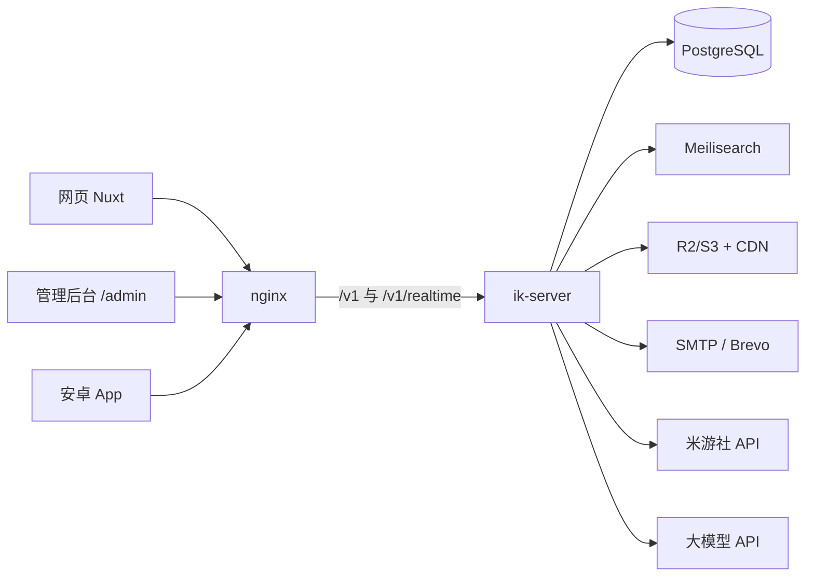

# 架构

## 总览

模块化单体：一个 `ik-server` 进程承担 HTTP API、WebSocket 网关、后台任务与定时任务、
AI 编排。外部依赖只有 PostgreSQL、Meilisearch、S3 兼容对象存储、SMTP/Brevo、米游社 API、
大模型 API。没有 Redis，没有 AstrBot，没有独立 worker 进程。



## crate 划分与依赖方向

```
kernel ◄── auth ◄── content ◄── feed
           ▲         ▲            ▲
           │         │            │
  social ──┤    messaging ── notify
  economy ─┤         ▲
  exam ────┤         │
  media    │        ai ── search
  moderation       ▲
   └───────────────┴──► server（唯一可依赖所有域的地方）
```

- `kernel`：不依赖任何业务域。提供配置、Problem 错误、ID、时间、游标、
  `AuthCtx`（鉴权上下文）、`EventBus` trait、任务入队 helper、限流 helper。
- 业务域 crate：`auth`、`content`（帖子/版块/标签/表情/帖子的赞藏与三连）、`comments`（评论与评论点赞）、
  `feed`（信息流/热榜/搜索）、`social`（关注/拉黑）、`economy`（丁尼/经验/签到/权益/装扮）、`exam`、
  `messaging`（私信）、`notify`（通知/收件箱）、`realtime`（WS 网关）、`media`（上传/文件）、
  `search`、`moderation`（举报/处罚/审计）、`ai`（供应商/模型/角色/编排/额度）、`admin`。
- 跨域只允许调用对方 `pub` 的 service；`repo` 层 `pub(crate)`，表归属唯一域。
- 需要与调用方同一事务的跨域写入，由被调用方提供接收 `&mut PgConnection` 的 interop 函数
  （如 `ik_auth::interop`、`ik_content::interop`、`ik_economy::service::grant_exp`）。
- 实际依赖：`economy → auth`；`social → auth`；`messaging → auth, social`；`notify → auth, social, messaging`；`search → auth, social, content, comments`；`media → auth`；content、comments、notify、messaging、profile 都依赖 media（封面、图片、头像）；
  `content → economy, social, notify`（发帖经验、投币、拉黑判断、通知）；
  `comments → content, economy, social, notify`；`exam → economy`（通过奖励）。economy 不能依赖 content，
  所以投币的入口在 content，记账在 economy。
- 拉黑几乎在每个读写路径上生效，所以 `social` 只放用户之间的关系（关注、拉黑），位于 content 之下，
  由 `ik_social::interop` 提供「任一方向拉黑」判断与列表过滤的排除集合。点赞、收藏、三连是帖子和评论
  上的数据，分别归 content、comments 所有，这样详情和列表可以直接带上「我是否已赞」。
- `feed → auth, content, comments`：热榜要合并点赞（content）与评论（comments）两类活动，所以在两者之上；
  各种信息流的 SQL 仍在 content（帖子表归它），feed 只负责热度计算与组合（把展示位 id 交给 content）。
- `profile → auth, social, economy, content, comments`：作者主页要汇总账号、关系、经验、帖子与评论，
  所以放在最上层，只调用各域的 service / interop；没有其他域依赖它。
- `realtime → auth`：WebSocket 网关（`ik_realtime::Hub`）是事件总线的唯一订阅者，按受众转发；
  会话吊销由 auth 发内部事件 `auth.sessions_changed`，网关收到后复查该用户的连接。
- `messaging → auth, social`：私聊会话与消息。位于 notify 之下：对方发来的通知要在通知的事务里推进收件人的私聊排序
  （`ik_messaging::interop::touch_direct`）。统一收件箱（私聊会话与通知分组混排、已读）在 `notify` 里组合两边的数据，
  所以实际依赖是 `notify → auth, social, messaging`。WS 的 `typing` 帧由 server 把 `ik_messaging::service::typing`
  注入网关（`RealtimeState::with_typing`），网关仍不依赖业务域。
- `search → auth, social, content, comments`：Meilisearch 只负责找候选与排序，结果经 content / comments 的 service
  回查数据库；建索引与数据库兜底的 SQL 也在这两个域里（`search_docs`、`search_post_ids` 等），search 不读它们的表。
  索引同步订阅事件总线（含 `Audience::Internal` 内部事件）、定时增量扫描、定期全量对账，在事务提交后独立执行。
- `media → auth`：直传上传、媒体文件与图库，位于业务域之下；引用媒体的域（profile 的头像、content 的封面、
  comments 的图片）经 `ik_media::interop::owned_media` 在自己的事务里校验归属，经 `MediaState::views` 取展示数据；
  content、comments、notify、messaging、profile 展示作者时经 `MediaState::avatar_urls` 把头像 id 换成缩略图地址。
  对象存储的读写都在数据库事务之外；校验并发由进程内闸门（`ik_media::gate`）限制。
- `notify` 同理位于 content 之下：各域在自己的事务里经 `ik_notify::interop` 写通知（帖子标题、评论摘要存快照），
  实时推送随调用方的 `Effects` 在提交后发出。
- `server` 组装一切：路由合并、中间件栈、任务注册、优雅停机。

## 请求处理流

```
HTTP → SetRequestId → Trace → CORS → CsrfLayer → 限流 → BodyLimit → Timeout
     → 路由 → 鉴权提取器（AuthCtx / MaybeAuth / RequireExam / RequireAdmin）
     → handler → service（事务）→ Problem/JSON
     ← CatchPanic ← 压缩（br/gzip）← 响应
```

- 每个请求有 `X-Request-Id`（客户端传了就沿用并校验格式，否则生成 UUIDv7）。
- 5xx 一律脱敏为 Problem + requestId；4xx 返回业务错误码与中文 detail。
- `#[axum::debug_handler]` 全开。

## 事务与副作用纪律

1. 一次业务写 = 一个 DB 事务：主表写入、计数原子增减、流水、任务入队同事务。
2. 任务入队用 graphile_worker 的 scoped executor（与业务同一连接同一事务）。
3. 实时事件、搜索同步、通知推送都在 **提交后** 发送（`after_commit` 收集器，
   由 service 返回 `Vec<Effect>`，server 层统一派发）。
4. 事务内禁止任何外部 IO（LLM、SMTP、S3、米游社）。

## 事件总线

进程内广播（dashmap 订阅表 + tokio broadcast）。定义为 `kernel::bus::EventBus` trait，
单机实现先行；需要多实例时换成 PG LISTEN/NOTIFY 实现，调用方不变。
WS 网关是唯一订阅者，按用户/会话/频道过滤后推送。

## 后台任务与定时任务

graphile_worker（schema `graphile_worker`，由它自己迁移：执行器启动时、`ik-server migrate` 时）。
`ik_kernel::jobs::Jobs` 负责入队（`enqueue` 接收业务事务的连接），任务由业务域定义，执行器在
`crates/server/src/jobs.rs` 统一登记任务、定时任务与执行时用的各域 state。

- 已实现：
  - `content.fanout_new_post`：首次发布且作者有粉丝时在发布事务里入队；每批 1000 条关注记录、一批一个事务，
    做完一批在同一事务里安排下一批；执行时帖子已下线、隐藏、删除就停止。最多 10 次尝试。
  - `media.sweep_staging`：定时任务，每小时第 17 分钟，清理过期的上传暂存对象。只尝试一次，失败等下个小时。
- 仍在进程内（每个实例各自做，不适合放进队列）：热榜刷新（结果是本实例的内存缓存）、搜索索引同步
  （订阅事件总线，失败的文档进重试表，另有定期对账）。
- 计划：会话清理、计数/余额对账、过期验证码/登录尝试清理（D-022）、AI 回复、举报处置、账号清理。
- 全部任务幂等（payload 带幂等键或天然可重入）。重试用 graphile_worker 的指数退避，`max_attempts` 写在任务定义旁；
  用完次数的任务留在队列表里（`attempts = max_attempts`，`last_error` 有原因），即死信，以后由管理后台处理。
- `IK_JOBS__RUN_WORKER=false` 时本实例只入队不执行；多实例时 graphile_worker 保证每个任务只被一个实例领取，
  定时任务也只安排一次。

## 实时

单条 WebSocket `/v1/realtime`（Cookie 或 Authorization 头鉴权）。
协议 `{ op, seq, t, d }`，详见 `docs/api-guidelines.md` 实时章节。
断线重连用 REST `?since=` 游标补齐；WS 只负责"提醒"，REST 是事实来源。

## 配置

- 编译期：`.env` 里的 `DATABASE_URL` 仅供 sqlx 宏。
- 运行时：环境变量 `IK_` 前缀（figment，`__` 分层），密钥类（HMAC key、SMTP 密码、
  LLM Key）支持从文件读取（`IK_SECRETS__*_FILE`）以便容器 secret 挂载。
- 非法配置启动即失败，禁止静默默认值兜底密钥。

## 观测

- tracing JSON 日志（dev 用 pretty），所有 span 带 request_id。
- `/metrics` Prometheus（请求、任务、WS 连接数、DB 池）。
- `/healthz`（存活）与 `/readyz`（DB ping + 迁移版本检查）。
